 <h1 align="center">Hey, I'm Raphael Kenji 👋</h1>

  <b>Software Developer · Backend · Automation · Observability</b>

  
  
  &nbsp;&nbsp;
  
  

---

### 🧭 A little about me

I'm a Software Developer and Computer Science graduate from **CEFET/RJ**, interested in what happens beyond the code itself.

I work across backend development, APIs, databases, automation, and observability. I enjoy understanding how systems fit together, making existing software easier to maintain, and improving the workflows that keep development moving.

### 🔭 What I'm exploring

- **Backend engineering**: APIs, integrations, SQL, and system modernization.
- **Infrastructure & automation**: CI/CD, Docker, infrastructure as code, and reusable workflows.
- **Observability & reliability**: metrics, telemetry, dashboards, and understanding what systems are doing.
- **AI-assisted development**: practical automation, engineering guardrails, and more reliable development workflows.

### 🛠️ My toolbox

<h4>Languages & Backend</h4>

  
  
  
  
  
  
  

<h4>Infrastructure & Automation</h4>

  
  
  
  
  

<h4>Observability, Messaging & Quality</h4>

  
  
  
  
  
  

---

### 📊 GitHub activity

  
  

---

  <a href="https://www.linkedin.com/in/raphaelkenji">LinkedIn</a> ·
  <a href="https://github.com/raphaelkenji">GitHub</a> ·
  <a href="https://www.instagram.com/raphvxkenji">Instagram</a>

